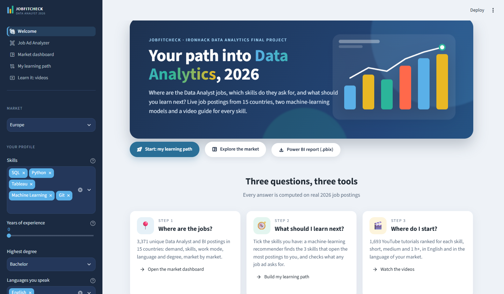
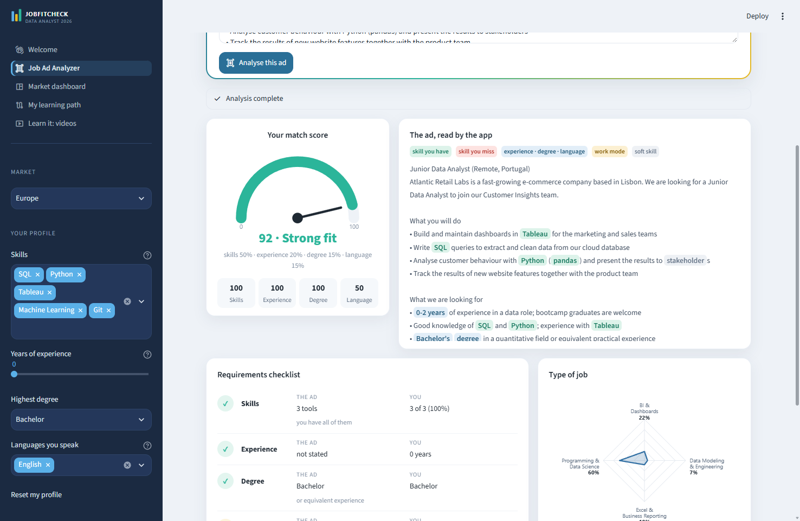
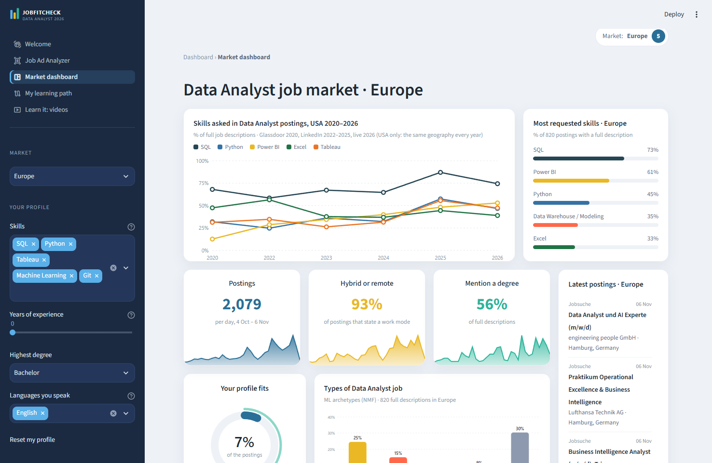
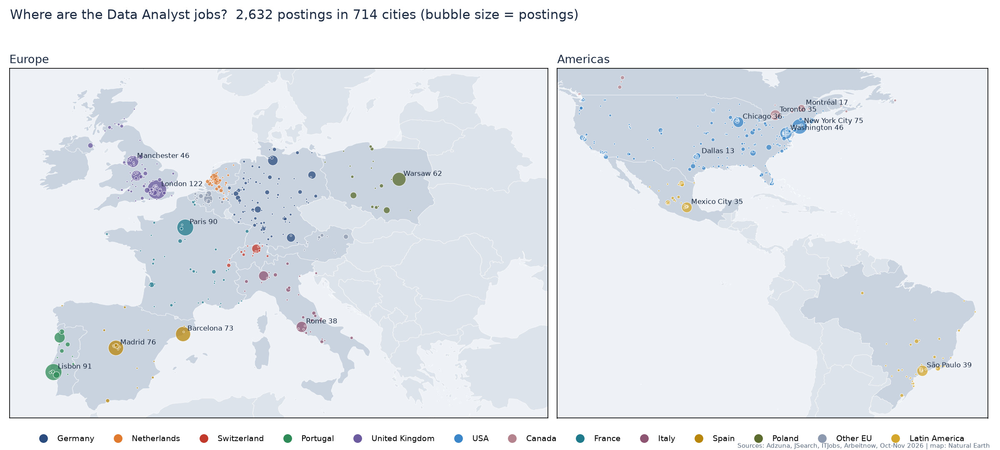
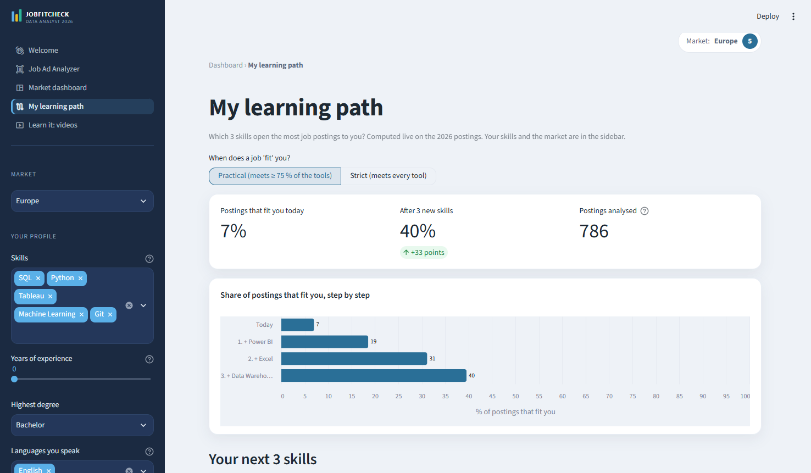

# JobFitCheck

**A job-fit coach for junior Data Analysts: paste a job ad, get your fit and your next step.**

Ironhack Data Analytics final project, November 2026. **2nd place** among all the student projects of the bootcamp.

| | |
|---|---|
| **Live app** | [jobfitcheck.streamlit.app](https://jobfitcheck.streamlit.app/) |
| **Power BI report** | [download JobMarket.pbix](https://github.com/pietroguido90-design/jobfitcheck/releases/latest/download/JobMarket.pbix) (Power BI Desktop, free) |



---

## The problem

We asked the 13 people in our bootcamp class where and how they want to work after the course. They all had the same question: **where do I fit?**

The 2026 market does not make it easy:

- Data & Analytics postings are **60–73% below their 2022 peak** (Germany −60%, USA −68%, UK −73%).
- About **9 in 10** postings in Germany and France ask for the local language, and most of Northern Europe is **hybrid, not remote**.
- With the skills the bootcamp teaches, a graduate fits only **6%** of the 2026 postings.

Job ads are wish lists, and nobody can read 3,000 of them to find out what really matters. So we read them for you.

## The product



| Page | What it does |
|---|---|
| **Job Ad Analyzer** | Paste any job ad: a match score from 0 to 100 (skills, experience, degree, language), the ad with every requirement highlighted, a checklist and a gap plan |
| **Market dashboard** | Demand, skills, work mode, degree and the latest postings for your market, and how much of it already fits your profile |
| **My learning path** | A machine-learning recommender picks the next skills that open the most postings in your market |
| **Learn it: videos** | 1,693 YouTube tutorials ranked for every skill, short, medium and 1 h+, in English and in the language of your market |



## Key findings

| | |
|---|---|
| **SQL** | asked in 7–8 postings out of 10, in every market and every year since 2020 |
| **Power BI** | grew 4× since 2020 and leads Tableau outside the USA (60% vs 32%) |
| **Language** | about 9 in 10 postings in Germany and France need the local language |
| **Work mode** | hybrid dominates Northern Europe (Netherlands 91%, Germany 83%); remote is realistic in Italy (53%) and Spain (46%) |
| **Degree** | mentioned in 56% of European and 75% of North American postings; 1 in 4 of them accept equivalent experience |
| **What to learn next** | Power BI and Excel take a bootcamp graduate from **6% to 30%** of the postings |



## How it works

```
5 job APIs ─► Python (cleaning, rule-based classification) ─► PostgreSQL star schema ─► 2 ML models ─► Power BI + Streamlit
```

- **Data collected by us:** 9,371 postings from 5 job APIs in one month (4 Oct – 6 Nov 2026); **3,371 unique** Data Analyst and BI postings in **15 countries** after cleaning and removing reposts. Trends from 2020 come from four historical Kaggle datasets and the Indeed Hiring Lab index.
- **Reading the ads:** multilingual rules (English, German, Dutch, French, Spanish, Portuguese, Italian, Polish) for 32 skills, seniority, work mode, language and degree requirements.
- **Validation:** skill rules match LLM-extracted tags with **≥ 96% precision**; degree rules 94% on a hand-checked sample; a TF-IDF near-duplicate check changes no share by more than 1 point; data quality checks after every database load.
- **Machine learning (scikit-learn):**
  1. **Job archetypes** with NMF on 4,212 full job descriptions (2020–2026): four types of Data Analyst job, identical in 5 of 5 runs.
  2. **Skill recommender**: greedy coverage + association rules, stable in 200 bootstrap resamples.
- **Outputs:** a 13-page Power BI report and the JobFitCheck Streamlit app.

Method notes: [first findings](docs/first_findings.md) · [education requirements](docs/education_requirements.md) · [near-duplicate check](docs/near_duplicates_check.md)

**Stack:** Python (pandas, scikit-learn), PostgreSQL, Power BI, Streamlit, YouTube Data API.



## Data sources and thanks

- **[OpenWeb Ninja](https://www.openwebninja.com/)**, our unofficial sponsor: their **JSearch API** provided 59% of the postings and 85% of the full job descriptions behind the skill analysis, the models and the Job Ad Analyzer. Thank you!
- Adzuna, the Bundesagentur für Arbeit (Jobsuche), ITJobs and Arbeitnow for their job data.
- Kaggle datasets (Glassdoor 2020, LinkedIn 2023–24, Data Analyst Skills Evolution 2022–26, ds_salaries) and the Indeed Hiring Lab for the trends.
- Our Ironhack teachers and classmates.

Full job ad texts are not published: they belong to the job boards and employers.

## Source code

The source code is kept in a private repository. **It is available on request**: open an issue or contact me through my GitHub profile.

---

© 2026 pietroguido90-design. All rights reserved. See [LICENSE](LICENSE).
